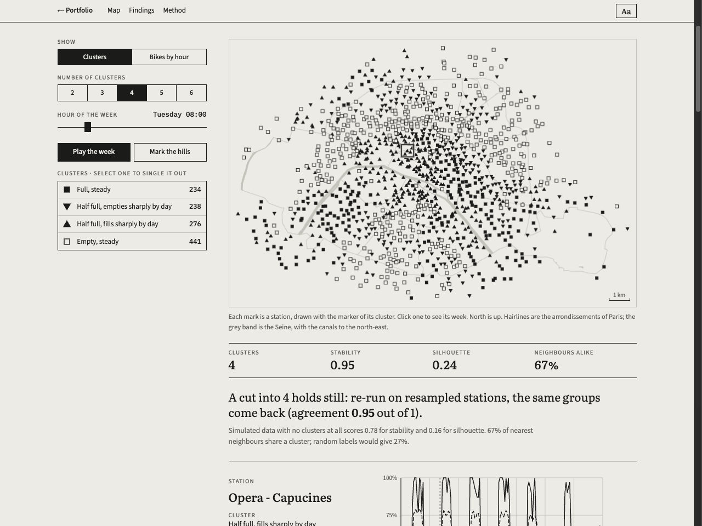

# Paris, drawn by its bikes

[](https://github.com/mcrimi/velib_weekly_cluster_analysis/actions/workflows/ci.yml)

A cluster analysis of the 1,189 stations of Vélib, the Paris bike-sharing system,
from one week of hourly readings. Built as a reproducible R pipeline, with an
interactive map that runs in the browser.

- **Explore it:** [the map](https://marianocrimi.com/velib/)
- **Read it:** [the full analysis](https://marianocrimi.com/velib/report/)



## What it finds

- **Two patterns carry 64% of the variation between stations.** The first
  principal component (40%) is how full a station is all week. The second (24%)
  is whether it fills or empties during the working day.
- **Clusters built from timetables alone are neighbourhoods.** The clustering
  sees 168 hourly numbers per station and no coordinates. With four clusters,
  67% of a station's six nearest neighbours share its cluster; random labels
  give 27%, and the highest of 999 shuffles was 30%.
- **The empty cluster is the hills.** 119 of the 127 uphill "bonus" stations
  (94%) land in one cluster, the one that is nearly always empty. They hold
  bikes in 16% of their docks, against 41% elsewhere.
- **There is no natural number of clusters, and the analysis says so.** The
  stations form a continuum: silhouettes are low, the gap statistic never
  peaks, and k-means and a Gaussian mixture agree only loosely. What *is* true
  is that cutting the continuum into two, three or four pieces is repeatable,
  and cutting it into five is not.

## Results

| K | Silhouette | Same, no clusters | Bootstrap stability (ARI) | Same, no clusters | Neighbours in same cluster | Expected if random |
|---|---|---|---|---|---|---|
| 2 | 0.28 | 0.22 | 0.96 | 0.90 | 79% | 52% |
| 3 | 0.27 | 0.18 | 0.96 | 0.60 | 73% | 35% |
| **4** | 0.24 | 0.16 | **0.95** | 0.78 | 67% | 27% |
| 5 | 0.23 | 0.14 | 0.80 | 0.70 | 62% | 23% |
| 6 | 0.17 | 0.13 | 0.87 | 0.63 | 53% | 18% |

"No clusters" is a simulated dataset with the same covariance as the real one,
drawn from a single Gaussian: a benchmark for what k-means reports when there
is nothing to find. Stability is the adjusted Rand index between the partition
and 100 re-runs on bootstrap samples of stations.

The four clusters at K = 4:

| Cluster | Stations | Mean loading | Bonus stations |
|---|---|---|---|
| Full, steady | 234 | 71% | 1 |
| Half full, empties sharply by day | 238 | 42% | 6 |
| Half full, fills sharply by day | 276 | 41% | 1 |
| Empty, steady | 441 | 17% | 119 |

## What changed from the 2021 version

I first did this as a course exam (`archive/`). Three things were wrong with it:

1. **A feature was counted twice.** Each station's weekly mean was appended to
   the data and the PCA, k-means and hierarchical clustering were run on all
   169 columns. The mean is a linear combination of the other 168.
2. **Complete linkage.** It merges on the single most distant pair, so a few
   odd stations shape the tree. This version uses Ward's method, which
   minimises the same criterion as k-means.
3. **K was chosen by eye** from a curve of explained variance. This version
   uses the gap statistic, silhouettes, bootstrap stability and a no-cluster
   benchmark, and reports that they do not single out a K.

It also had no seed, so results changed from run to run.

## How it is built

```
data/raw/velib.Rdata                1,189 stations × 181 hours
 └─ clean      R/data.R       drop the incomplete first day -> 168 hours
     ├─ pca        R/pca.R        principal components
     ├─ cluster    R/cluster.R    k-means · Ward · Gaussian mixtures
     │                            gap · silhouette · bootstrap · benchmark
     ├─ spatial    R/spatial.R    join counts, Moran's I, bonus stations
     ├─ basemap    R/basemap.R    arrondissements and waterways, simplified
     ├─ report     report/index.qmd   Quarto
     └─ export     R/export.R     web/data/*.json ──→ web page
                                  web/test/fixtures.json ──→ parity test
```

Three things are worth pointing out.

**Geography is held out.** Coordinates and the bonus flag are never inputs to
the clustering. They are used afterwards, as tests of whether the clusters mean
anything.

**A benchmark for "no structure".** Every validity index is also computed on a
structureless dataset with the same covariance, so a silhouette of 0.24 can be
read against 0.16 and not against an imagined ideal.

**The page computes, and is tested against R.** The browser holds each station's
week and the cluster centres. `web/js/model.js` works out distances, nearest
centres and principal component scores. `R/export.R` writes fixtures computed
in R *from the JSON as exported*, and `web/test/model.test.js` must reproduce
them to nine decimal places.

The page itself is plain HTML, CSS and ES modules, with no build step and no
map tiles. The stations are drawn on a canvas in ink, clusters differ by
marker shape, not colour, and the outline of Paris underneath is 850 points of
simplified open data (`R/basemap.R`), about 12 kB.

## Run it

Needs R 4.4, [Quarto](https://quarto.org) and Node 20 or later.

```sh
Rscript -e 'renv::restore()'                         # packages, from renv.lock
Rscript -e 'targets::tar_make()'                     # everything, about two minutes
Rscript -e 'testthat::test_dir("tests/testthat")'    # 164 expectations
npm test                                             # 18 tests, including R-to-JS parity
python3 -m http.server -d web 8000                   # the page, at http://localhost:8000
```

## Data

The data are the `velib` dataset of Bouveyron, Côme and Jacques (2015), *The
discriminative functional mixture model for a comparative analysis of bike
sharing systems*, Annals of Applied Statistics 9(4), 1726-1760,
[doi:10.1214/15-AOAS861](https://doi.org/10.1214/15-AOAS861). They collected
it from the operator's open data service and distribute it in the R package
[`funFEM`](https://CRAN.R-project.org/package=funFEM). It holds the loading
(bikes available divided by docks) of each station every hour from a Sunday
morning to the following Sunday night in early September 2014, with station
names, coordinates and the bonus flag.

On licensing, plainly: `funFEM` is released under GPL-2, and the file here is
that package's dataset saved as `.Rdata`. The underlying readings came from
JCDecaux's open data service. I have not found a separate licence statement
for the dataset itself. The MIT licence in this repository covers my code
only, not the data. If you reuse the data, take it from `funFEM` and cite the
paper.

The base map under the stations (`data/raw/paris_arrondissements.geojson` and
`data/raw/paris_waterways.geojson`) comes from the City of Paris open data
portal, [opendata.paris.fr](https://opendata.paris.fr/): the datasets
"Arrondissements" and "Plan de voirie - Voies d'eau", both published under the
Open Database Licence (ODbL). It is drawn for the reader only and takes no
part in the analysis.

## Limitations

One week of one city in 2014; the system was replaced in 2018. Loading is not
demand: an empty station hides how many riders were turned away, and the
operator's own trucks are in the data. Euclidean distance on 168 columns does
not know that neighbouring hours are related; the functional methods of the
original paper do, and are not reproduced here.

## Licence and citation

Code is MIT licensed. See `CITATION.cff`.
